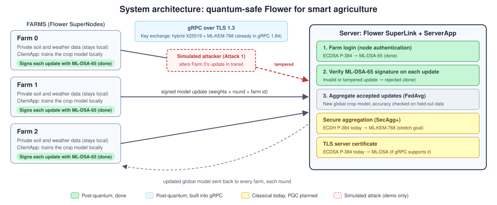
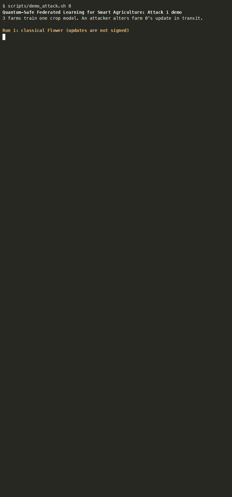
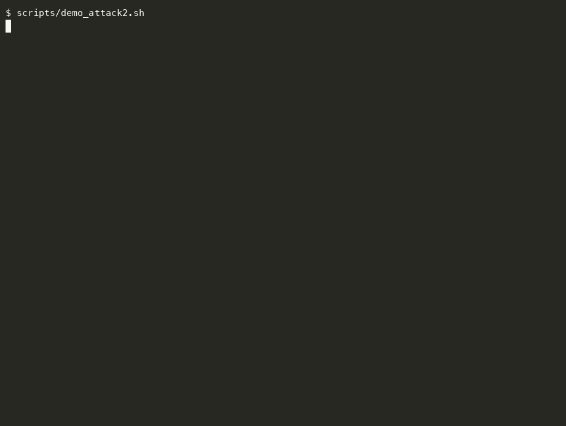

# Quantum-Safe Federated Learning for Smart Agriculture

Group project: Augustine Manu-Frimpong, David Orisakwe, Kimora Mclemore

We take [Flower](https://github.com/flwrlabs/flower), an open-source federated learning framework, and replace its classical cryptography with post-quantum cryptography (PQC). Several simulated farms train one shared model without sharing their raw sensor data.

**Selected topics**
1. PQC for IoT and Smart Agriculture: the farms and their sensor data are the use case.
2. PQC-Enabled Federated Learning Systems: Flower's connections and authentication become quantum-safe.
3. Trustworthy AI with PQC-Based Authentication: model updates are signed, so forged or tampered updates are rejected.

**Network protocol:** gRPC over TLS 1.3

## Architecture



The full design, including the step-by-step flow of one training round and a map of the code, is in [docs/ARCHITECTURE.md](docs/ARCHITECTURE.md).

## Where Flower uses classical cryptography (Flower 1.39.0)

| Layer | Flower today | File | PQC replacement |
|---|---|---|---|
| Transport: key exchange | TLS 1.3, **already hybrid X25519MLKEM768** with grpcio 1.84 | `supercore/grpc.py` | Verify, measure, and keep (pin grpcio) |
| Transport: certificates | ECDSA P-384 (classical) | our `scripts/gen_credentials.sh` | ML-DSA certificates if gRPC supports them, else documented limitation |
| Node authentication | ECDSA P-384 signature over a **timestamp** in gRPC metadata | `supercore/primitives/asymmetric.py`, `client/grpc_rere_client/node_auth_client_interceptor.py` | ML-DSA-65 (**done**, `pqc` mode) |
| Secure aggregation (SecAgg+) | ECDH P-384 pairwise keys, then HKDF and Fernet | `common/secure_aggregation/crypto/symmetric_encryption.py`, `client/mod/secure_aggregation/secaggplus_mod.py` | ML-KEM |
| Model update integrity | **None.** Updates are not signed. | none | ML-DSA signature on each update |

## Findings so far (2026-10-13)

- **Node auth does not cover the model update.** The SuperNode signs only the current timestamp. A forged or tampered update is not detected by this signature, so topic 3 adds a protection Flower does not have today.
- **PQC primitives are available in the library Flower already uses.** `cryptography` 50.0.2 (OpenSSL 3.5) has `mlkem` (768, 1024) and `mldsa` (44, 65, 87). Flower pins `cryptography<47`, so we override the pin (`overrides.txt`).
- **Flower's TLS key exchange is already hybrid post-quantum.** With grpcio 1.84 on both ends, a farm offers X25519MLKEM768 first and the SuperLink picks it (`results/tls_handshake_flower_1.39_2026-10-13.txt`). This comes from gRPC's bundled TLS library, not from Flower. Server *authentication* (certificates) is still classical ECDSA, and older grpcio versions fall back to classical X25519.
- **Upstream:** Flower has no issues or PRs about post-quantum crypto. The closest is [#6896](https://github.com/flwrlabs/flower/issues/6896) (mTLS node auth, classical).

### Classical vs PQC primitives (Apple M5 Pro, Python 3.12, `explore/bench_primitives.py`)

| Algorithm | Keygen (µs) | Op 1 (µs) | Op 2 (µs) | Public key (B) | Sig/ciphertext (B) |
|---|---|---|---|---|---|
| ECDSA P-384 (Flower) | 44 | 368 sign 1 MB | 444 verify | 97 | ~103 |
| ML-DSA-44 | 40 | 1,103 | 922 | 1,312 | 2,420 |
| ML-DSA-65 | 74 | 1,264 | 942 | 1,952 | 3,309 |
| ML-DSA-87 | 100 | 1,399 | 993 | 2,592 | 4,627 |
| ECDH P-384 (Flower) | 45 | 100 exchange | none | 97 | 97 |
| ML-KEM-768 | 36 | 9 encaps | 13 decaps | 1,184 | 1,088 |
| ML-KEM-1024 | 52 | 12 encaps | 17 decaps | 1,568 | 1,568 |

Takeaway: ML-KEM is about 10× faster than Flower's ECDH but sends about 12× more bytes. ML-DSA signs a 1 MB update about 3× slower than ECDSA, with 23–45× larger signatures. Both are small next to a model update of several MB.

## Classical baseline (2026-10-13)

Flower deployment mode on one laptop: one SuperLink (server) and 3 SuperNodes (farms) talking over real gRPC. Simulation mode skips the network, so it can't exercise TLS or node auth.

- **Data:** crop recommendation dataset, 2,200 samples, 7 features (soil N/P/K, temperature, humidity, pH, rainfall), 22 crops. 20% is held out as a test set. The rest is split non-IID across farms (Dirichlet α = 0.5), so each farm has 18–22 of the 22 crops.
- **Model:** softmax regression in NumPy, trained with FedAvg (20 local epochs, lr 1.0).
- **Result:** test accuracy 3.6% → **90.7% after 15 rounds**, matching 90.5% for pooled (non-federated) training. Mean round time is 9.8 s, almost all Flower scheduling/polling. See `results/baseline_classical_insecure_3farms_2026-10-13.txt`.
- **Note:** Flower installs each run's dependencies in a separate environment (with `cryptography` 46). The PQC version must declare `cryptography>=50` in `pyproject.toml`.

### With Flower's built-in security (TLS 1.3 + ECDSA farm login)

`scripts/run_local.sh classical 3 15`: TLS on the gRPC link, and every farm's ECDSA P-384 key registered on the SuperLink. Test accuracy **90.9% after 15 rounds**, mean round time ~9.4 s, the same as without security. Verified during the run: plaintext gRPC is rejected, and a farm with an unregistered key is refused (exit code 305).

## Attack 1 demo: tampered model update (2026-10-15)

Farms can sign every model update with **ML-DSA-65** (`sign-updates = true`). The signature covers the round number, the farm id and the weights. The server (`SignedFedAvg`) drops any update whose signature fails. A simulated attacker (`attack-farm = 0`) alters farm 0's update in transit, flipping and amplifying its weights. It cannot re-sign the update without farm 0's private key.

All runs use 3 farms, 15 rounds, TLS 1.3 + ECDSA farm login (`results/attack1_*`):

| Run | Final test accuracy |
|---|---|
| Signed updates, no attack | 90.7% (signing costs no accuracy) |
| Attack, **unsigned** (how Flower behaves today) | **10.0%**, model ruined |
| Attack, **ML-DSA signed** | **82.5%**, tampered update rejected every round; the model trains on the 2 honest farms |

Attack 1 is stopped by *signing* updates; any secure signature would do. The post-quantum part, a simulated quantum attacker forging a farm's classical key, is Attack 2.

```bash
scripts/demo_attack.sh 8    # same attack, unsigned then signed (recording: demo/attack1_demo.gif)
```



## ML-DSA-65 farm login (2026-10-18)

`scripts/run_local.sh pqc 3 15` runs the same system with every farm logging in with an **ML-DSA-65** key instead of ECDSA P-384. `pqcflower/pqc_login.py` patches only Flower's five farm-login call sites: the farm's key loading, request signing, `flwr supernode register`, the server's registration check, and the server's signature check. ECDSA keys keep working, and secure aggregation (which shares the same helpers for ECDH) is left untouched. The `pqc-flower-superlink`, `pqc-flower-supernode` and `pqc-flwr` commands are Flower's own commands with the patch applied.

| Farm login | Test accuracy (15 rounds) | Mean round time | Login data per request |
|---|---|---|---|
| ECDSA P-384 (classical) | 90.9% | 9.4 s | ~0.3 KB (public key 215 B + signature ~103 B) |
| **ML-DSA-65** | **90.9%** | 9.45 s | **6.1 KB** (public key 2,726 B + signature 3,309 B), ~8.1 KB on the wire |

Verified (`explore/login_forgery_probe.py`, run against a live server):
- The server stores 2,726-byte ML-DSA public keys; there is no silent fallback to ECDSA.
- Forged login (farm 0's public key, attacker's signature) → `UNAUTHENTICATED: Invalid signature`.
- A farm with an unregistered ML-DSA key cannot activate (`No SuperNode found with the given public key`).
- The 6.1 KB login headers fit within gRPC's metadata limits.

Round time moves in ~3 s steps set by Flower's polling, so it cannot show millisecond costs; the benchmark harness will measure login overhead directly.

## Attack 2 demo: simulated quantum attacker impersonates a farm (2026-10-18)

Farm 0's login *public* key is public: it is sent in every login request. A large quantum computer running Shor's algorithm could turn an elliptic-curve public key into its private key. No such machine exists, so `pqcflower/attack2_quantum.py` **simulates** one with an oracle: for an ECDSA key it returns farm 0's real private key, checked to match; for an ML-DSA key it fails, because no quantum algorithm is known to break ML-DSA. The attacker then logs in to a live SuperLink (TLS 1.3) as farm 0, with farm 0 registered but offline.

| Farm login | Quantum key recovery (simulated) | Login as farm 0 | Result |
|---|---|---|---|
| ECDSA P-384 (classical Flower) | private key **recovered** | **accepted**, server activates the attacker as farm 0 | **impersonation succeeds** |
| **ML-DSA-65** (ours) | **fails** | **rejected**: `UNAUTHENTICATED: Invalid signature` | impersonation blocked |

This is the post-quantum point of the project: Attack 1 shows updates must be signed, and Attack 2 shows the signatures must be quantum-safe.

```bash
scripts/demo_attack2.sh     # recording: demo/attack2_demo.gif
```



## What PQC costs (benchmark, 2026-10-18)

`benchmarks/pqc_costs.py` measures the cost directly; round time moves in ~3 s polling steps and cannot show it. Results: `results/pqc_costs_2026-10-18.txt` / `.json` (Apple M5 Pro).

| | Classical | Post-quantum | Comment |
|---|---|---|---|
| Farm login: sign / verify, per request | ECDSA 68 / 151 µs | ML-DSA-65 289 / **68** µs | ML-DSA verifies faster, signs ~4× slower |
| Farm login headers, per request (on the wire) | 520 B | 8,140 B | public key + signature sent every request |
| **Login traffic per farm per round** (37 requests) | 18.8 KB | **297 KB** | **the main cost of PQC here** |
| Login signing time per farm per round | 2.5 ms | 10.8 ms | negligible next to a ~9 s round |
| TLS handshake (once per connection) | X25519: 1,228 B | X25519MLKEM768: 3,495 B | +2,267 B, no measurable time |
| Signed model update: sign / verify | none | 257 / 67 µs | |
| Signature vs update size | none | 3,309 B on a 1,408 B update (+235%) | +0.03% on a 10 MB update |

**Finding:** the post-quantum maths costs microseconds. What costs is Flower's login design: it attaches the full public key and a fresh signature to every request (~37 per farm per round), so ML-DSA's larger keys and signatures add ~280 KB per farm per round, about 200× our model update. Authenticating once per session (or sending the key only at activation) would remove most of this.

## Setup and run

```bash
uv venv -p 3.12 .venv
uv pip install -p .venv -r requirements.txt --override overrides.txt -e .   # or: uv sync
scripts/get_data.sh
scripts/run_local.sh classical 3 15   # TLS + ECDSA login, 3 farms, 15 rounds (or: insecure)
scripts/run_local.sh pqc 3 15         # TLS + ML-DSA-65 login
scripts/stop_all.sh                  # stop leftover Flower processes if a run reports busy ports
.venv/bin/python explore/bench_primitives.py
```

## Next steps

- [x] Run a baseline Flower deployment with several farms (classical, no TLS yet)
- [x] Add classical TLS + node auth to the baseline (the real "before" for comparison)
- [x] Settle the gRPC client group question: hybrid X25519MLKEM768 is already negotiated
- [ ] Decide the classical reference for TLS (pin an older grpcio for a true classical X25519 baseline?)
- [x] Swap node auth ECDSA → ML-DSA (`pqc` mode)
- [ ] Swap SecAgg+ ECDH → ML-KEM
- [x] Sign model updates with ML-DSA; demo a tampered update being rejected (Attack 1)
- [x] Attack 2: simulated quantum attacker (ECDSA key oracle) impersonating a farm
- [x] Measure login, signing and handshake cost, classical vs PQC (`benchmarks/pqc_costs.py`)
- [ ] Scale to more farms (3 → 20) and chart the results

## Prototype dashboard (2026-10-22)

A local web page that drives the real system: pick the security mode, sign updates on or off,
switch Attack 1 on, and watch the shared model's accuracy and the server's decision on every farm
update, round by round. Attack 2 runs from two buttons (ECDSA login vs ML-DSA login), and the
measured PQC costs are shown alongside.

```bash
.venv/bin/python dashboard/server.py     # then open http://127.0.0.1:8765
```
