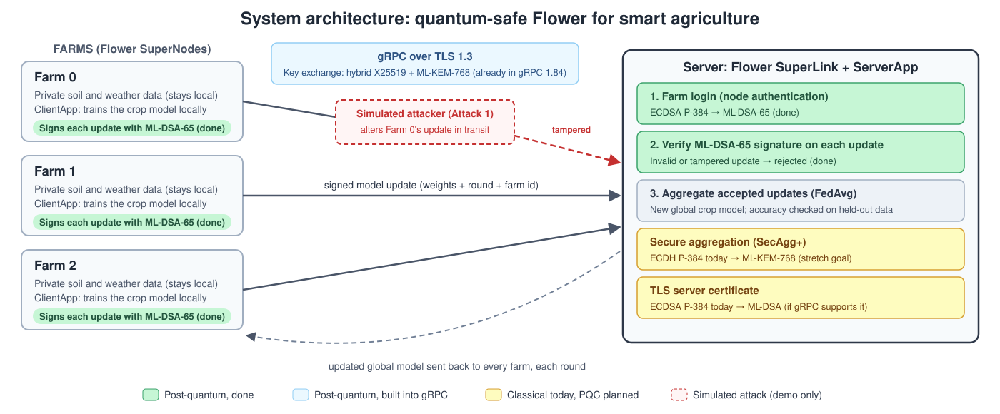
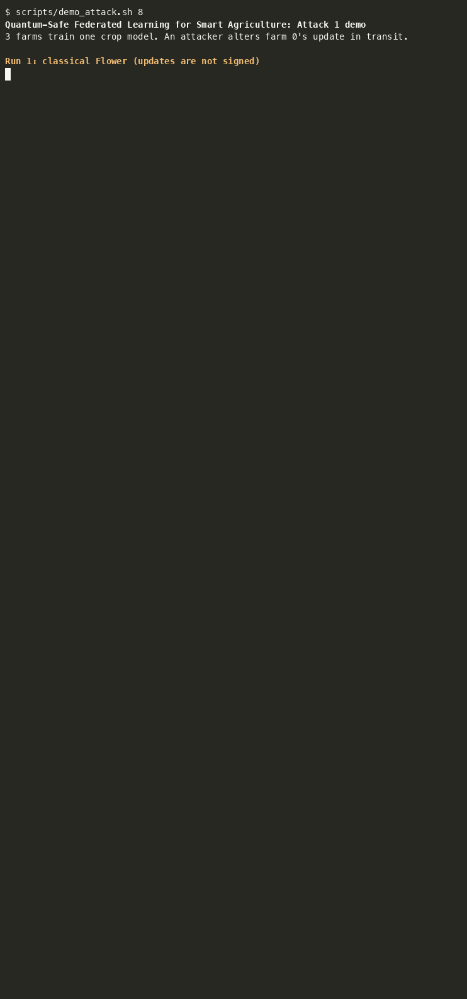
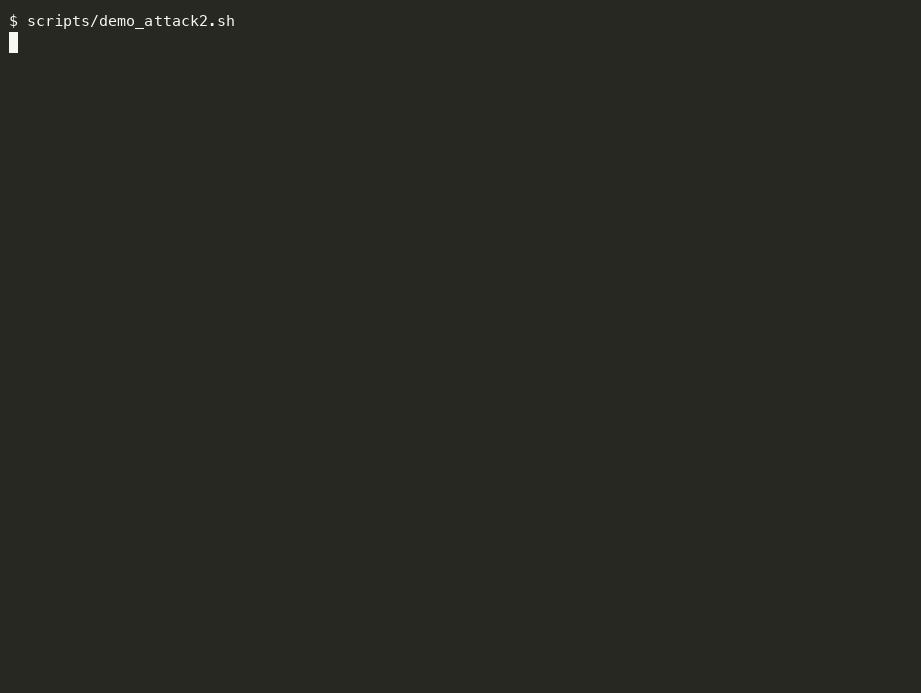
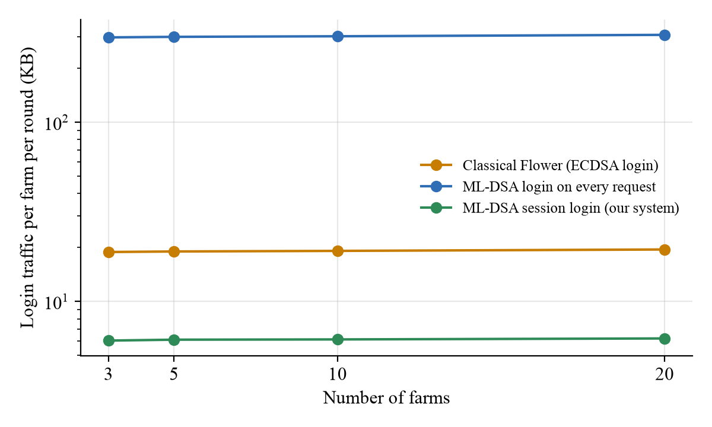

# Quantum-Safe Federated Learning for Smart Agriculture

Group project: Augustine Manu-Frimpong, David Orisakwe, Kimora Mclemore

We take [Flower](https://github.com/flwrlabs/flower), an open-source federated learning framework, and replace its classical cryptography with post-quantum cryptography (PQC). Several simulated farms train one shared model without sharing their raw sensor data.

**Selected topics**
1. PQC for IoT and Smart Agriculture: the farms and their sensor data are the use case.
2. PQC-Enabled Federated Learning Systems: Flower's connections and authentication become quantum-safe.
3. Trustworthy AI with PQC-Based Authentication: model updates are signed, so forged or tampered updates are rejected.

**Network protocol:** gRPC over TLS 1.3

## Architecture



The full design, including the step-by-step flow of one training round and a map of the code, is in [docs/ARCHITECTURE.md](docs/ARCHITECTURE.md).

## Where Flower uses classical cryptography (Flower 1.39.0)

| Layer | Flower today | File | PQC replacement |
|---|---|---|---|
| Transport: key exchange | TLS 1.3, **already hybrid X25519MLKEM768** with grpcio 1.84 | `supercore/grpc.py` | Verify, measure, and keep (pin grpcio) |
| Transport: certificates | ECDSA P-384 (classical) | our `scripts/gen_credentials.sh` | ML-DSA certificates if gRPC supports them, else documented limitation |
| Node authentication | ECDSA P-384 signature over a **timestamp** in gRPC metadata | `supercore/primitives/asymmetric.py`, `client/grpc_rere_client/node_auth_client_interceptor.py` | ML-DSA-65 (**done**, `pqc` mode) |
| Secure aggregation (SecAgg+) | ECDH P-384 pairwise keys, then HKDF and Fernet | `common/secure_aggregation/crypto/symmetric_encryption.py`, `client/mod/secure_aggregation/secaggplus_mod.py` | ML-KEM |
| Model update integrity | **None.** Updates are not signed. | none | ML-DSA signature on each update |

## Findings so far (2026-10-13)

- **Node auth does not cover the model update.** The SuperNode signs only the current timestamp. A forged or tampered update is not detected by this signature, so topic 3 adds a protection Flower does not have today.
- **PQC primitives are available in the library Flower already uses.** `cryptography` 50.0.2 (OpenSSL 3.5) has `mlkem` (768, 1024) and `mldsa` (44, 65, 87). Flower pins `cryptography<47`, so we override the pin (`overrides.txt`).
- **Flower's TLS key exchange is already hybrid post-quantum.** With grpcio 1.84 on both ends, a farm offers X25519MLKEM768 first and the SuperLink picks it (`results/tls_handshake_flower_1.39_2026-10-13.txt`). This comes from gRPC's bundled TLS library, not from Flower. Server *authentication* (certificates) is still classical ECDSA, and older grpcio versions fall back to classical X25519.
- **Upstream:** Flower has no issues or PRs about post-quantum crypto. The closest is [#6896](https://github.com/flwrlabs/flower/issues/6896) (mTLS node auth, classical).

### Classical vs PQC primitives (Apple M5 Pro, Python 3.12, `explore/bench_primitives.py`)

| Algorithm | Keygen (µs) | Op 1 (µs) | Op 2 (µs) | Public key (B) | Sig/ciphertext (B) |
|---|---|---|---|---|---|
| ECDSA P-384 (Flower) | 44 | 368 sign 1 MB | 444 verify | 97 | ~103 |
| ML-DSA-44 | 40 | 1,103 | 922 | 1,312 | 2,420 |
| ML-DSA-65 | 74 | 1,264 | 942 | 1,952 | 3,309 |
| ML-DSA-87 | 100 | 1,399 | 993 | 2,592 | 4,627 |
| ECDH P-384 (Flower) | 45 | 100 exchange | none | 97 | 97 |
| ML-KEM-768 | 36 | 9 encaps | 13 decaps | 1,184 | 1,088 |
| ML-KEM-1024 | 52 | 12 encaps | 17 decaps | 1,568 | 1,568 |

Takeaway: ML-KEM is about 10× faster than Flower's ECDH but sends about 12× more bytes. ML-DSA signs a 1 MB update about 3× slower than ECDSA, with 23–45× larger signatures. Both are small next to a model update of several MB.

## Classical baseline (2026-10-13)

Flower deployment mode on one laptop: one SuperLink (server) and 3 SuperNodes (farms) talking over real gRPC. Simulation mode skips the network, so it can't exercise TLS or node auth.

- **Data:** crop recommendation dataset, 2,200 samples, 7 features (soil N/P/K, temperature, humidity, pH, rainfall), 22 crops. 20% is held out as a test set. The rest is split non-IID across farms (Dirichlet α = 0.5), so each farm has 18–22 of the 22 crops.
- **Model:** softmax regression in NumPy, trained with FedAvg (20 local epochs, lr 1.0).
- **Result:** test accuracy 3.6% → **90.7% after 15 rounds**, matching 90.5% for pooled (non-federated) training. Mean round time is 9.8 s, almost all Flower scheduling/polling. See `results/baseline_classical_insecure_3farms_2026-10-13.txt`.
- **Note:** Flower installs each run's dependencies in a separate environment (with `cryptography` 46). The PQC version must declare `cryptography>=50` in `pyproject.toml`.

### With Flower's built-in security (TLS 1.3 + ECDSA farm login)

`scripts/run_local.sh classical 3 15`: TLS on the gRPC link, and every farm's ECDSA P-384 key registered on the SuperLink. Test accuracy **90.9% after 15 rounds**, mean round time ~9.4 s, the same as without security. Verified during the run: plaintext gRPC is rejected, and a farm with an unregistered key is refused (exit code 305).

## Attack 1 demo: tampered model update (2026-10-15)

Farms can sign every model update with **ML-DSA-65** (`sign-updates = true`). The signature covers the run id, the round number, the farm id and the weights. The server (`SignedFedAvg`) drops any update whose signature fails. A simulated attacker (`attack-farm = 0`) alters farm 0's update in transit, flipping and amplifying its weights. It cannot re-sign the update without farm 0's private key.

All runs use 3 farms, 15 rounds, TLS 1.3 + ECDSA farm login (`results/attack1_*`):

| Run | Final test accuracy |
|---|---|
| Signed updates, no attack | 90.7% (signing costs no accuracy) |
| Attack, **unsigned** (how Flower behaves today) | **10.0%**, model ruined |
| Attack, **ML-DSA signed** | **82.5%**, tampered update rejected every round; the model trains on the 2 honest farms |

Attack 1 is stopped by *signing* updates; any secure signature would do. The post-quantum part, a simulated quantum attacker forging a farm's classical key, is Attack 2.

```bash
scripts/demo_attack.sh 8    # same attack, unsigned then signed (recording: demo/attack1_demo.gif)
```



## ML-DSA-65 farm login (2026-10-18)

`scripts/run_local.sh pqc 3 15` runs the same system with every farm logging in with an **ML-DSA-65** key instead of ECDSA P-384. `pqcflower/pqc_login.py` patches only Flower's five farm-login call sites: the farm's key loading, request signing, `flwr supernode register`, the server's registration check, and the server's signature check. ECDSA keys keep working, and secure aggregation (which shares the same helpers for ECDH) is left untouched. The `pqc-flower-superlink`, `pqc-flower-supernode` and `pqc-flwr` commands are Flower's own commands with the patch applied.

| Farm login | Test accuracy (15 rounds) | Mean round time | Login data per request |
|---|---|---|---|
| ECDSA P-384 (classical) | 90.9% | 9.4 s | ~0.3 KB (public key 215 B + signature ~103 B) |
| **ML-DSA-65** | **90.9%** | 9.45 s | **6.1 KB** (public key 2,726 B + signature 3,309 B), ~8.1 KB on the wire |

Verified (`explore/login_forgery_probe.py`, run against a live server):
- The server stores 2,726-byte ML-DSA public keys; there is no silent fallback to ECDSA.
- Forged login (farm 0's public key, attacker's signature) → `UNAUTHENTICATED: Invalid signature`.
- A farm with an unregistered ML-DSA key cannot activate (`No SuperNode found with the given public key`).
- The 6.1 KB login headers fit within gRPC's metadata limits.

Round time moves in ~3 s steps set by Flower's polling, so it cannot show millisecond costs; the benchmark harness will measure login overhead directly.

## Attack 2 demo: simulated quantum attacker impersonates a farm (2026-10-18)

Farm 0's login *public* key is public: it is sent in every login request. A large quantum computer running Shor's algorithm could turn an elliptic-curve public key into its private key. No such machine exists, so `pqcflower/attack2_quantum.py` **simulates** one with an oracle: for an ECDSA key it returns farm 0's real private key, checked to match; for an ML-DSA key it fails, because no quantum algorithm is known to break ML-DSA. The attacker then logs in to a live SuperLink (TLS 1.3) as farm 0, with farm 0 registered but offline.

| Farm login | Quantum key recovery (simulated) | Login as farm 0 | Result |
|---|---|---|---|
| ECDSA P-384 (classical Flower) | private key **recovered** | **accepted**, server activates the attacker as farm 0 | **impersonation succeeds** |
| **ML-DSA-65** (ours) | **fails** | **rejected**: `UNAUTHENTICATED: Invalid signature` | impersonation blocked |

This is the post-quantum point of the project: Attack 1 shows updates must be signed, and Attack 2 shows the signatures must be quantum-safe.

```bash
scripts/demo_attack2.sh     # recording: demo/attack2_demo.gif
```



## What PQC costs (benchmark, 2026-10-18)

`benchmarks/pqc_costs.py` measures the cost directly; round time moves in ~3 s polling steps and cannot show it. Results: `results/pqc_costs_2026-10-18.txt` / `.json` (Apple M5 Pro).

| | Classical | Post-quantum | Comment |
|---|---|---|---|
| Farm login: sign / verify, per request | ECDSA 68 / 151 µs | ML-DSA-65 289 / **68** µs | ML-DSA verifies faster, signs ~4× slower |
| Farm login headers, per request (on the wire) | 520 B | 8,140 B | public key + signature sent every request |
| **Login traffic per farm per round** (37 requests) | 18.8 KB | **297 KB** | **the main cost of PQC here** |
| Login signing time per farm per round | 2.5 ms | 10.8 ms | negligible next to a ~9 s round |
| TLS handshake (once per connection) | X25519: 1,228 B | X25519MLKEM768: 3,495 B | +2,267 B, no measurable time |
| Signed model update: sign / verify | none | 257 / 67 µs | |
| Signature vs update size | none | 3,309 B on a 1,408 B update (+235%) | +0.03% on a 10 MB update |

**Finding:** the post-quantum maths costs microseconds. What costs is Flower's login design: it attaches the full public key and a fresh signature to every request (~37 per farm per round), so ML-DSA's larger keys and signatures add ~280 KB per farm per round, about 200× our model update. Authenticating once per session (or sending the key only at activation) would remove most of this.

## Session-based login (2026-10-22)

Fixes the cost found above. `pqc-session` mode (`pqcflower/session_login.py`): the farm logs in
with ML-DSA-65 once; the SuperLink then issues a session (16 B ID + 32 B key, sent back inside
TLS 1.3, whose key exchange is hybrid X25519 + ML-KEM-768). Later requests carry only the session
ID, a timestamp and an HMAC-SHA256 tag over the RPC method and timestamp. Sessions expire after
10 minutes (`PQC_SESSION_TTL`); on expiry or a SuperLink restart the farm logs in with ML-DSA again.

```bash
scripts/run_local.sh pqc-session 3 15
.venv/bin/python benchmarks/pqc_costs.py --only-session      # results/pqc_session_<date>.*
```

Measured on real training runs (3 farms, 5 rounds; `results/pqc_session_2026-10-22.txt`):

| Farm login | Auth traffic per farm per round | ML-DSA verifications (whole run) |
|---|---|---|
| Classical ECDSA, every request | 18.8 KB | none (ECDSA) |
| ML-DSA-65, every request (`pqc`) | 301.7 KB | 570 |
| **ML-DSA-65 once, then session (`pqc-session`)** | **7.1 KB (42× less)** | **3** (one per farm) |

Post-quantum login now costs *less* traffic than Flower's classical login. Accuracy is unchanged:
90.9% after 15 rounds, as in `classical` and `pqc` mode. Checked against a live
SuperLink with `explore/session_probe.py`: a valid session is accepted; a wrong MAC, an unknown
session, a tag computed for another RPC, a 10-minute-old timestamp, a session used for another
farm's node ID and a forged ML-DSA login are all rejected (`UNAUTHENTICATED`). Attack 2 is still
rejected, since a session can only be obtained with a valid ML-DSA login.

**Why it is still quantum-safe:** the session key is random and only travels inside hybrid
post-quantum TLS; HMAC-SHA256 keeps 128-bit security against quantum attackers (Grover's algorithm
only halves it). The identity check is still ML-DSA, once per session.

## Scaling from 3 to 20 farms (2026-11-08)

`benchmarks/scaling.py` runs the full system with 3, 5, 10 and 20 farms in three modes, 15 rounds
each, all with TLS 1.3: classical Flower as shipped (ECDSA login, unsigned updates), ML-DSA-65 login
on every request, and our system (ML-DSA-65 session login). Both post-quantum modes also sign every
update with ML-DSA-65. Results in `results/scaling_2026-11-08.txt`, charts in `docs/paper/scaling_*.png`.

| Farms | Accuracy (classical / ML-DSA every request / session) | Mean round time | Login traffic per farm per round | ML-DSA login checks (whole run) |
|---|---|---|---|---|
| 3 | 90.9% / 90.9% / 90.5% | 9.2 / 9.9 / 9.9 s | 18.9 / 297.7 / **6.0 KB** | 1,685 → **3** |
| 5 | 81.6% / 83.2% / 81.6% | 10.1 / 10.5 / 11.1 s | 19.0 / 299.7 / **6.1 KB** | 2,828 → **5** |
| 10 | 85.9% / 86.1% / 86.8% | 11.9 / 11.3 / 11.6 s | 19.1 / 302.0 / **6.1 KB** | 5,698 → **10** |
| 20 | 83.4% / 83.2% / 82.3% | 12.7 / 13.1 / 13.0 s | 19.5 / 307.5 / **6.2 KB** | 11,604 → **20** |

- **Accuracy:** post-quantum security costs no accuracy at any size; the three modes stay within
  1.6 points of each other. Accuracy changes with the farm count because the same data is split
  into smaller, more uneven pieces, not because of the security.
- **Round time:** grows from about 9 s to 13 s from 3 to 20 farms in every mode; the security mode
  adds well under a second. Rounds are dominated by Flower's scheduling and polling.
- **Login traffic per farm stays flat** as farms are added (each farm sends about 38 requests per
  round), so the server's total login traffic grows linearly: at 20 farms, per-request ML-DSA login
  is about 6 MB per round, classical login 390 KB, and session login 124 KB.
- **ML-DSA login checks** on the server: one per farm per run with sessions, against about 39 per
  farm per round without.

Login traffic for the classical and per-request runs is requests × header size (516 B ECDSA,
8,140 B ML-DSA, from `benchmarks/pqc_costs.py`); the session figure is measured bytes.

```bash
PQC_CONTROL_PORT=8001 .venv/bin/python benchmarks/scaling.py    # ~45 min; resumes if interrupted
.venv/bin/python benchmarks/scaling.py --charts-only             # redraw the charts
```



## Replay protection and Attack 3 (2026-11-08)

A replay sends a genuine, correctly signed message a second time. Two places allowed it:

- **Model updates.** The update signature covered the round and the farm id, but not the training
  run. An update recorded in round 3 of one run still carried a valid signature in round 3 of the
  next run. The signature now also covers the run id (`pqcflower/signing.py`, message format v2).
- **Farm login.** Flower accepts a signed login for 305 s after its timestamp, so a recorded
  request could be sent again inside that window. In `pqc-session` mode the SuperLink now remembers
  every session MAC and full-login signature it accepted until it leaves that window, and refuses
  a second copy (`ReplayGuard` in `pqcflower/session_login.py`).

**Attack 3** (`replay-farm = 0`, `pqcflower/attack.py`): the simulated attacker records farm 0's
updates as they pass (kept in `logs/captured/`, so they outlive the run) and swaps each new update
for an old one with its genuine signature: the same round from an earlier run if it has one,
otherwise the previous round.

```bash
scripts/demo_attack3.sh 4    # unsigned, then signed (previous round), then signed (earlier run)
```

| Run | Farm 0's replayed update |
|---|---|
| Unsigned updates (Flower today) | accepted every round |
| Signed, replay of the previous round | rejected (round does not match) |
| Signed, replay of the same round from an earlier run | rejected (run id does not match); accepted before this change |

`explore/session_probe.py` now also sends the same session request twice and the same full ML-DSA
login twice; both second copies are rejected.

## Post-quantum secure aggregation: SecAgg+ with ML-KEM-768 (2026-11-08)

Secure aggregation hides each farm's model update from the server: farms add random masks that
cancel only in the sum. Flower's SecAgg+ builds those masks, and the keys that protect the secret
shares between farms, with ECDH P-384, which Shor's algorithm breaks. `secure-aggregation = "mlkem"`
runs our version (`pqcflower/secagg_pq.py`); `"ecdh"` runs Flower's own.

ECDH lets two farms compute a shared secret without messaging each other; ML-KEM does not (one side
encapsulates, the other must receive the ciphertext). Our version keeps Flower's four stages and
puts the KEM ciphertexts into the messages the server already forwards:

- **Shares between farms:** encrypted with a key from an ML-KEM encapsulation to the neighbour.
- **Pairwise mask seeds:** the farm with the lower id creates the seed from its own secret master
  and sends it to the other farm inside a second encapsulation.
- **Dropouts:** what each farm secret-shares for recovery is its decapsulation seed plus that
  master, so the server can rebuild every mask of a farm that drops out (from the master, or by
  decapsulating the stored capsule), revealing no more than Flower does with ECDH.
- **Mask generator:** Flower's `pseudo_rand_gen` XOR-folds the 32-byte seed into 32 bits, so every
  mask is one of 2^32. We seed the generator with the full seed.

Checked with `benchmarks/secagg_costs.py` (real Flower workflow and farm code, in one process) and
live runs (`results/secagg_costs_2026-11-08.txt`):

| | Flower SecAgg+ (ECDH) | Our SecAgg+ (ML-KEM-768) |
|---|---|---|
| Aggregate vs plain weighted average, 5 farms | equal (6e-5, quantization) | equal (5e-5) |
| Same, one farm drops out after sharing keys | equal | equal (its masks rebuilt) |
| Live, 3 farms, 15 rounds: accuracy / mean round | 90.7% / 19.0 s | 90.5% / 17.0 s |
| SecAgg+ traffic per farm per round, 3 / 20 farms (sent + received) | 6.0 / 34.3 KB | 19.2 / 127.8 KB |
| Key-sharing stage per farm, 3 / 20 farms | 1.4 / 19.3 ms | 0.6 / 8.0 ms |
| Mask seed space | 2^32 | full 256-bit seed |

ML-KEM costs about 3–4× more SecAgg+ bytes (1,184-byte public keys, 1,088-byte ciphertexts) but is
faster than ECDH. Secure aggregation itself roughly doubles the round time in both versions
(about 10 s → 17–19 s), because each round needs four exchanges with the farms instead of one.
With secure aggregation the server never sees a single update, so update signatures (Attack 1/3
protection) are off in that mode.

```bash
scripts/run_local.sh pqc-session 3 15 'secure-aggregation="mlkem"'   # or "ecdh"
.venv/bin/python benchmarks/secagg_costs.py
```

## Setup and run

```bash
uv venv -p 3.12 .venv
uv pip install -p .venv -r requirements.txt --override overrides.txt -e .   # or: uv sync
scripts/get_data.sh
scripts/run_local.sh classical 3 15   # TLS + ECDSA login, 3 farms, 15 rounds (or: insecure)
scripts/run_local.sh pqc 3 15         # TLS + ML-DSA-65 login
scripts/stop_all.sh                  # stop leftover Flower processes if a run reports busy ports
PQC_CONTROL_PORT=8001 scripts/run_local.sh classical 3 15   # if another app already uses port 8000
.venv/bin/python explore/bench_primitives.py
```

## Next steps

- [x] Run a baseline Flower deployment with several farms (classical, no TLS yet)
- [x] Add classical TLS + node auth to the baseline (the real "before" for comparison)
- [x] Settle the gRPC client group question: hybrid X25519MLKEM768 is already negotiated
- [x] Classical reference for TLS: measured directly (openssl client, X25519 vs X25519MLKEM768 against our SuperLink, `benchmarks/pqc_costs.py` C): +2,267 B per handshake, no measurable time; no older grpcio needed
- [x] Swap node auth ECDSA → ML-DSA (`pqc` mode)
- [x] Swap SecAgg+ ECDH → ML-KEM (`secure-aggregation = "mlkem"`, `pqcflower/secagg_pq.py`)
- [x] Sign model updates with ML-DSA; demo a tampered update being rejected (Attack 1)
- [x] Attack 2: simulated quantum attacker (ECDSA key oracle) impersonating a farm
- [x] Measure login, signing and handshake cost, classical vs PQC (`benchmarks/pqc_costs.py`)
- [x] Session-based login: one ML-DSA login per session (`pqc-session` mode), 42× less auth traffic
- [x] Scale to more farms (3 → 20) and chart the results (`benchmarks/scaling.py`)
- [x] Replay protection: run id in update signatures, replay window on farm login; Attack 3 demo

## Prototype dashboard (2026-10-22)

A local web page that drives the real system: pick the security mode (including session login),
sign updates on or off, switch Attack 1 or Attack 3 on, turn on secure aggregation (ECDH or ML-KEM), and watch the shared model's accuracy and the server's decision on every farm
update, round by round. Attack 2 runs from two buttons (ECDSA login vs ML-DSA login), and the
measured PQC costs are shown alongside.

```bash
.venv/bin/python dashboard/server.py     # then open http://127.0.0.1:8765
```
